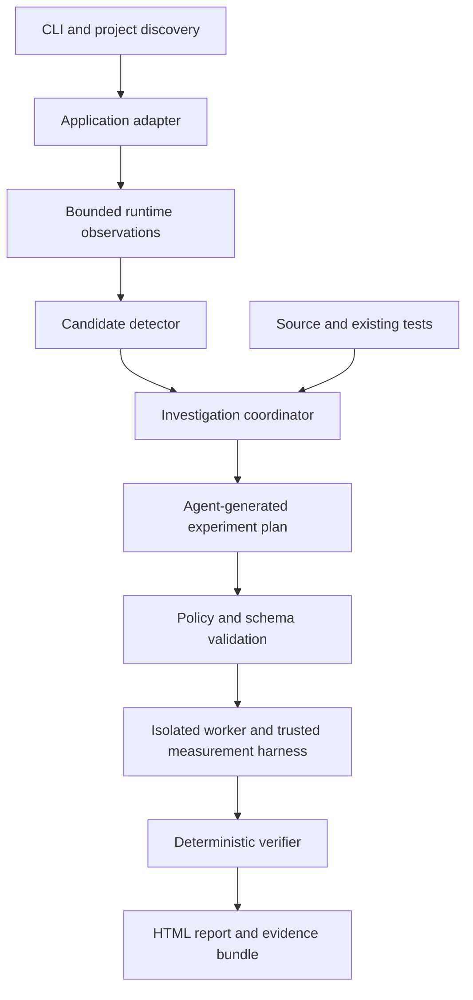

# Fault Finder — Phase 1 Technical Design Document

**Scope:** Automated investigation of Python memory retention
**Status:** Proposed design; capabilities and acceptance targets below are requirements, not completed features
**Interface:** CLI and a self-contained HTML evidence report
**Date:** 26 October 2026

## 1. What we are building

FaultFinder observes a supported Python application or test workload, identifies suspicious memory growth, uses agents to investigate likely causes, and attempts to reproduce the problem in an isolated environment. It produces a report explaining what remained alive, what retained it, how the finding was verified, and the measured impact.

**Phase 1 succeeds when a developer can install and configure it once, then receive reproducible memory-retention findings without writing a reproduction for each finding.** Automatic verification is conditional on the tool having runnable source, dependencies, and a usable workload. When those are missing, it must explain the gap rather than manufacture a result.

This is a technical design document (TDD). Implementation should start with one working end-to-end path before expanding detection coverage.

## 2. Scope and support contract

| Area | Phase 1 commitment |
|---|---|
| Language/runtime | CPython 3.11 and 3.12 initially, tested separately. This is a deliberate support boundary, not a claim about the latest Python versions. |
| Execution platform | Linux containers on x86-64. Windows development through WSL2 and Linux containers. Native Windows verification is deferred. |
| First integrations | Existing pytest suites; a FastAPI/Starlette ASGI adapter for request lifecycle observation. |
| Other Python projects | Process-level observation and source triage. Automatic verification only where a usable test or generated harness can be validated. |
| Process model | One application process per observed session. Detect child processes and report coverage gaps; automatic multi-process attribution is deferred. |
| Memory defects | Completed objects retained by listeners/callbacks, registries/collections, or completed task/result references. |
| Cache growth | Detect growth; call it a bug only when evidence establishes a missing bound, expiry, or violated lifecycle contract. |
| Delivery | CLI package, pytest plugin, ASGI integration, worker container, offline HTML and JSON reports. |

CPU profiling, race detection, deadlocks, native/C-extension leaks, GPU memory, automatic source fixes, and automatic PR creation are outside this phase. Threads and asyncio may be present in the target; this phase investigates their object retention, not concurrency correctness.

The architecture should accept future runtime adapters, but the first release must say **“Python support”**, not “works with every project.”

## 3. Input, process, and output

### Input

One-time setup supplies the application launch command or test command, source location, dependency environment, and whether execution is production observation or isolated investigation. A container deployment also supplies an immutable image/version mapping to the corresponding source.

FaultFinder then discovers package metadata, Python version, test configuration, and supported integrations. Discovery reads files such as `pyproject.toml`; it does not import arbitrary application modules on the host.

Normal application traffic or existing tests provide activity. Production collection records operation counts and lifecycle metadata, not request bodies, credentials, or object contents. Tests and fixtures are the preferred reproduction input. An optional, explicitly configured sanitized replay source may be added for applications without suitable tests.

**No traffic, no tests, and no runnable workload means no runtime verification.** Source analysis can still produce hypotheses.

### Process

Detect environment → observe workload → identify candidate → inspect source → build experiment → reproduce in isolation → apply deterministic verification rules → generate report.

One successful reproduction is insufficient. Verification includes repeated trials, different workload sizes, lifecycle checks, and controls that distinguish a defect from normal allocation behavior.

### Output

Each investigation produces:

- `report.html`: summary, charts, explanation, evidence, limitations, and reproduction instructions.
- `evidence.json`: versioned machine-readable measurements and verdict reasons.
- A reproduction bundle: harness, experiment manifest, environment references, and sanitized logs.

Reports distinguish **suspected**, **reproduced retention**, **verified retention bug**, and **inconclusive**. A completed scan without findings says **“No evidence found in the exercised workload,”** not “No memory leaks.”

## 4. User experience

These commands describe the intended interface; they are not promises that the existing prototype implements it.

```sh
faultfinder inspect .
faultfinder watch -- uvicorn app:app --workers 1
faultfinder check -- pytest tests
faultfinder report <investigation-id>
faultfinder replay <bundle-directory>
```

`inspect` explains detected support, missing dependencies, and usable entry points. `watch` starts lightweight observation; an installed worker automatically investigates eligible candidates under the configured policy. `check` runs an investigation using tests inside the isolated worker. `replay` repeats a saved experiment.

Docker delivery uses two components: an integration inside the application process and a separate investigation worker. A sidecar alone cannot identify Python object ownership. Installation can be packaged as a Compose example, but application integration and access to the correct source/image still require one-time setup.

The user should not have to identify suspicious functions or author test cases for each alert. If automatic harness generation fails, the tool retains the candidate and records why verification was blocked.

## 5. Architecture



### Application integration

Track process identity, elapsed time, RSS, completed operations, and active operations. The ASGI adapter tracks request completion, exceptions, cancellation, and streaming response completion. Request completion alone does not prove that all related background work should have ended.

Use bounded buffers and queues. Instrumentation must not retain request objects, responses, exception tracebacks, or task results. Internal failures disable the collector and emit a diagnostic rather than breaking application requests.

### Investigation coordinator

Associate observations with the correct source version and runtime, deduplicate candidates, enforce cooldowns and experiment budgets, and persist job state. Start with one worker job at a time. A restarted coordinator must not lose completed evidence or run the same job repeatedly.

### Worker

Build or use a pinned test environment, execute a generated harness, and collect measurements independently of the agents. Application code and generated harnesses run only here. The worker must validate that the workload actually exercised the suspected path and completed correctly.

### Verifier

Apply a versioned decision policy to trusted measurements, controls, and lifecycle evidence. An agent cannot set a verified verdict, change a threshold after seeing results, or convert a failed execution into a successful test.

## 6. Technology stack

| Component | Choice | Purpose and expectation |
|---|---|---|
| Core implementation | Python, typed modules | Keep runtime integration, measurement, and orchestration in one language. |
| Packaging | `pyproject.toml`, uv, locked dependencies | Reproducible development and worker builds. Keep the target application's dependency environment separate from the controller. |
| CLI | Typer and Rich | Commands, progress, readable summaries, and explicit non-success states. |
| Runtime metrics | psutil | Process memory and health. RSS is a trend signal, not leak proof. |
| Allocation evidence | Standard-library `tracemalloc` | Compare traced Python allocations in diagnostic runs. |
| Retention evidence | `gc`, `weakref`, bounded reference inspection | Track selected object lifetimes and ownership paths in isolated runs. |
| Workload integration | pytest plugin; ASGI adapter | Reuse tests and observe request lifecycle boundaries. |
| Schemas | Pydantic | Validate plans, observations, evidence, and report inputs. |
| Agent execution | Explicit Python state machine plus local Ollama API client | Bounded agent roles without requiring a large agent framework. One local model can serve all roles sequentially. |
| Isolation | Docker worker | Separate experiments from the monitored application and apply resource restrictions. |
| Persistence | SQLite plus artifact directories | Store job state and metadata; keep snapshots and logs outside database rows. |
| Reports | Jinja2 with autoescaping, embedded SVG charts | Self-contained HTML with no CDN or external service requirement. |
| Quality checks | pytest, pytest-asyncio, Ruff, mypy | Validate runtime behavior, formatting, and typed interfaces. |
| Optional diagnostic | Memray, isolated Linux runs | Supplemental allocation investigation; not required for the first release or its verdicts. |

`tracemalloc` attributes traced allocations to source locations and supports snapshot comparisons. It introduces overhead and does not explain every retained reference or cover all process memory; enable it at the start of worker trials. [Python documentation](https://docs.python.org/3.12/library/tracemalloc.html)

GC inspection sees only the objects/references supported by Python's collector interfaces and can itself introduce references. Avoid retaining inspected objects in the collector and do not enable `DEBUG_SAVEALL` in verification runs. [Python GC documentation](https://docs.python.org/3.12/library/gc.html)

Keep RSS separate from USS/private-memory measurements. More detailed process memory queries may require additional privileges and cost more than basic sampling; capability-detect the installed psutil API and report unavailable measurements explicitly. [psutil API](https://psutil.io/api/)

Memray supports Linux and macOS, with WSL tested; it is not a native Windows dependency for this design. [Supported environments](https://bloomberg.github.io/memray/supported_environments.html)

No paid model API is required. Local model quality and hardware capacity must be evaluated before selecting a default model. If no model is available, observation and existing deterministic probes remain usable, but autonomous source investigation is reported as unavailable.

## 7. Agent responsibilities

| Role | Input | Output | Restriction |
|---|---|---|---|
| Investigator | Candidate metrics, relevant source, existing tests | Hypothesis identifying the expected lifetime and possible retaining owner | May propose a cause; cannot claim measurements it did not receive. |
| Reproduction planner | Hypothesis and available fixtures | Typed experiment plan and bounded harness | Cannot execute commands directly or access production credentials. |
| Evidence reviewer | Actual trial results and code context | Alternative explanations, missing evidence, concise report narrative | Cannot override the verifier's verdict. |

These are roles, not three permanently running model servers. Use one model sequentially first. Persist model identifier, prompt-template version, generated harness hash, and attempts. Maximum initial budget: two harness revisions per candidate; unresolved failures become inconclusive.

Repository text, logs, and model output are untrusted data. Only allowlisted orchestration operations are executable. Generated Python is still arbitrary code and must remain inside the restricted worker; schema validation is not a sandbox.

## 8. Features to implement

| ID | Required feature | Completion expectation |
|---|---|---|
| F1 | Project and capability discovery | Detect supported interpreter, tests, source version, and unsupported execution modes without running application imports on the host. |
| F2 | Lifecycle-aware monitoring | Record counts and memory with bounded overhead; handle success, exceptions, and cancellation without retaining application objects. |
| F3 | Candidate detection | Identify sustained growth after warm-up, normalize by completed work where available, and suppress duplicate investigations. |
| F4 | Source triage | Connect runtime evidence to plausible ownership code; AST patterns alone remain hypotheses. |
| F5 | Automatic harness generation | Reuse fixtures/tests, preserve the relevant lifecycle, and verify that the suspected path was reached. |
| F6 | Isolated execution | Reproduce against matching source/dependencies with time, memory, CPU, process, and output limits. |
| F7 | Retention verification | Repeat experiments, run controls, inspect ownership, and distinguish retained objects from ordinary RSS behavior. |
| F8 | Evidence and reporting | Generate offline HTML/JSON, raw trial records, metadata, limitations, and a replayable bundle. |
| F9 | Operational reliability | Recover queued jobs, limit storage, stop safely, and expose instrumentation or model failures. |
| F10 | Evaluation corpus | Exercise real and seeded defects plus healthy controls; publish measured coverage and overhead. |

## 9. Detection and verification policy

### Candidate detection

Production mode samples process metrics at a configurable interval, initially five seconds. Exclude a configurable warm-up period, initially sixty seconds, and require several observation windows before escalating. These are starting settings to benchmark, not universal thresholds.

Compare memory growth with completed operation counts and in-flight work. If operation boundaries are unavailable, use time-based growth only as weaker evidence. An idle or insufficiently exercised service produces an insufficient-data result.

Deep allocation tracing, heap traversal, forced collection, and stress workloads run in the isolated worker by default. This means the first production signal can be coarse; the design must not promise allocation-level attribution from RSS samples alone.

### Experiment protocol

1. Resolve the source revision, dependency versions, and target interpreter. Dirty source requires a recorded diff or content hashes.
2. Validate a normal workload outcome before measuring memory. An exception or skipped suspected path invalidates that trial.
3. Warm the process, settle known background activity, and record a baseline. Define a maximum settling time; do not wait indefinitely.
4. Run increasing workloads. The initial template uses 0, 100, 500, and 1,000 completed operations, with three fresh-process repetitions per size.
5. Run a relevant healthy/negative control with the same protocol. For example, omit the shared signal while keeping the operation count equal. A separately supplied fixed revision is useful corroboration, but not required for discovery.
6. In the worker, measure after natural cleanup and again after explicit GC where applicable. Remove references introduced by measurement before counting survivors.
7. Collect traced-byte differences, selected surviving-object counts, and a bounded retaining-reference path where available. Keep the measurements distinct.
8. Confirm whether the observations violate an expected lifetime. Cite a tested cleanup contract, completed lifecycle, or documented bound. If intent is uncertain, retain the weaker verdict.

The default template is 24 trials including one control: four sizes × three repetitions × two variants. Reduce or adapt workloads before execution when the budget requires it, and record the deviation. Missing or failed trials are never entered as zero retention.

Use a predeclared noise tolerance derived from healthy controls and report individual trials plus median and range. Exact object-lifetime invariants are stronger evidence than a byte-growth threshold. Finite experiments demonstrate retention over the tested range; they do not mathematically prove indefinite growth.

### Verdict rules

| Verdict | Required evidence |
|---|---|
| Suspected | Runtime trend or source hypothesis; reproduction has not established retention. |
| Reproduced retention | Repeatable surviving objects or traced growth after the exercised work; intended ownership or cause is still uncertain. |
| Verified retention bug | Valid repeated workload, retained objects beyond an established lifetime, causal ownership evidence, and relevant controls that support the explanation. |
| Inconclusive | Missing environment, unstable reproduction, failed controls, unsupported allocation type, exceeded budget, or insufficient evidence. |

Report lifecycle expectations with their source. An agent's assertion that an object “should be freed” is insufficient. A cache that intentionally retains objects within its policy must not be marked as a verified bug.

## 10. Evidence report contract

Lead with the verdict and a concrete statement such as:

> After 1,000 completed operations, 1,000 child controllers remained reachable through callbacks registered on a shared signal. The no-shared-signal control retained zero controllers. The tested cleanup contract requires completed operations to detach these callbacks.

This is an illustrative report shape based on the BeeAI case, not a measurement performed by this proposed system.

Include:

- Finding ID, detector/verifier versions, timestamps, and source locations.
- Source commit plus dirty-state hashes; runtime, OS, dependency lock hash, and image digest.
- Workload origin, completion/settling definition, sizes, repeats, random seeds when relevant, and controls.
- Each trial's outcome, object counts, traced bytes, and process-memory samples where available.
- Ownership explanation and the evidence supporting the expected lifetime.
- Charts of retained counts/bytes against completed operations, including controls.
- Reproduction command, harness hash, failed attempts, and known coverage limits.

Measured impact must use the quantity actually observed: objects retained per operation or traced bytes retained over the tested workload. Do not turn object counts into invented MB savings or claim production savings from a synthetic experiment. Any extrapolation must be separately labeled with its assumptions.

## 11. Execution and data safeguards

Production collection must not execute generated tests, force garbage collection, or replay live requests. It records bounded metadata and queues investigations for the isolated worker.

Worker defaults: non-root process, read-only source mount, separate writable scratch area, no production secrets, no Docker socket, restricted network, CPU/memory/PID limits, wall-clock timeout, and bounded logs. Dependency installation happens in a separate controlled preparation stage. A workload needing a database must use a configured disposable test service; otherwise it is inconclusive.

Container isolation reduces risk but is not an absolute security boundary. This phase assumes the user is investigating their own trusted project; arbitrary hostile repositories require stronger isolation beyond this design.

Store no object representations or request payloads by default. Escape all report content, redact configured sensitive fields, and enforce retention/size limits for artifacts. Keep the local model local unless the user explicitly configures a cloud provider.

## 12. Reliability and performance requirements

The following are release targets to validate, not existing performance claims:

| Requirement | Acceptance target |
|---|---|
| Observation overhead | At most 5% degradation in throughput and p95 latency on the declared reference workloads, measured with and without observation over repeated runs. Publish hardware and variation. |
| Collector retention | Internal buffers remain within configured caps during 100,000 operations; no references to completed request objects remain after cleanup. |
| Experiment budget | Default one active job, 15-minute timeout per job, 2 GiB memory cap; report budget exhaustion explicitly. Workloads may configure larger budgets. |
| Fault behavior | Collector failure does not change target responses. Verification failure cannot yield a verified finding. |
| Storage | Bounded queue, artifact quota, and retention cleanup; verified evidence can be exported before local expiry. |
| Reproducibility | Saved bundle reruns successfully in the pinned environment; missing dependencies or images are detected before a verdict. |
| Report portability | HTML opens offline with charts and no external requests. |

Heavy profiling overhead is reported separately from observation overhead. A target failing these budgets is not silently treated as supported.

## 13. Testing and evaluation

Build a versioned corpus with at least these cases:

| Case | Expected result |
|---|---|
| Shared signal retains completed controllers | Verified retention bug when the cleanup contract and ownership path are established. |
| Registry retains completed request/session objects | Verified retention bug. |
| Collection retains completed task results beyond its cleanup contract | Verified retention bug. |
| Bounded cache reaches a plateau | No verified bug. |
| Lazy imports and initialization | Warm-up growth, no verified bug. |
| Temporary cyclic objects released by GC | No verified bug. |
| Large allocation freed while RSS remains elevated | No verified bug based on RSS alone. |
| Legitimately active background work | No verified bug while its lifetime is valid. |
| Native allocation growth not covered by the adapter | Explicit limitation/inconclusive result. |
| Missing credentials, failed workload, or timeout | Inconclusive result with the actual cause. |

Use the original BeeAI defect and fixed version as a real regression pair, with pinned source revisions. Add a second independent Python project before claiming generality. Keep some corpus cases hidden from agent prompts to reduce overfitting.

Test units for schemas and verdict rules; integration tests for pytest/ASGI lifecycles and containers; end-to-end tests for discovery through report replay. Include collector cleanup, cancellation, streaming requests, worker crashes, malformed agent output, and unavailable models.

Release gate: all supported known-positive cases produce the expected finding, healthy controls produce no verified false positives, and held-out results are published as counts and precision/recall with their corpus scope. This small corpus does not establish accuracy across all Python projects.

## 14. Implementation sequence

1. **Reliable measurement first.** Implement the trusted worker harness, lifetime measurements, evidence schema, controls, and verifier against a known retention example. No model is required yet.
2. **Integrate real workloads.** Add discovery, pytest integration, ASGI lifecycle observation, source/version mapping, and capability reporting.
3. **Automate investigation.** Add the three agent roles, bounded harness generation, path-exercise checks, and policy validation. Demonstrate a finding without a user-authored reproduction.
4. **Complete delivery.** Add persistent job management, CLI, offline reports, replay bundles, and container packaging.
5. **Qualify the release.** Run the corpus and independent-project evaluations, measure overhead, exercise failure modes, and publish the support matrix and limitations.

Suggested module boundaries: `discovery`, `adapters`, `observer`, `detection`, `agents`, `worker`, `verification`, `evidence`, `reporting`, and `cli`. Define typed interfaces between them before expanding the implementation.

## 15. Definition of done

Phase 1 is complete when a supported application can be integrated once; normal tests/activity trigger a candidate; agents generate a valid reproduction; isolated repeated trials establish or reject the hypothesis; and the user receives a replayable report with honest measured impact.

The release must also pass its healthy controls, overhead targets, collector-cleanup tests, and worker-failure tests. Automatic detection of every leak, universal project support, and production memory savings are not Phase 1 completion claims.
